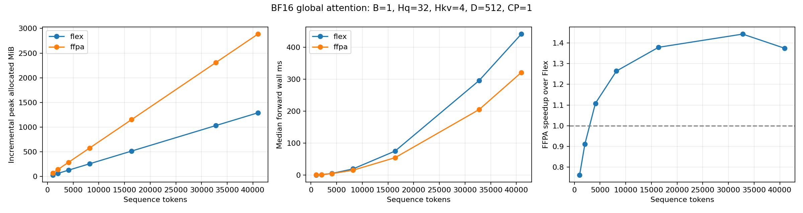

# Gemma 4 benchmark results

> Historical planning/benchmark record. The current native FSDP2/Flex/Ulysses
> run and its dated results are described in [the runtime guide](src/nl2sql_verl/README.md)
> and [WORK_LOG.md](WORK_LOG.md). Older AutoModel proposals and pending
> statements below describe their original experiment stage.

## TP=2 forward comparison and capacity measurement — 2026-10-23

The new requested layouts are TP2/CP1 on GPUs 0–1 and TP2/CP2 on GPUs 0–3.
Each GPU holds approximately 29.663 GiB of parameters. The harness applies
AutoModel's Gemma-owned TP plan with the standard tied-weight/head handling,
then the model-owned ring sharder. TP groups in the four-rank layout are
`[0,1]`/`[2,3]`; CP groups are `[0,2]`/`[1,3]`. There is no FSDP or CPU offload.
The plan comes from the pinned AutoModel source; NVIDIA also publishes
[Gemma 4 tensor-parallel recipes](https://docs.nvidia.com/nemo/automodel/latest/model-coverage/vision-language-models/gemma-4).

All runs use batch size one, BF16 weights and ring Flex attention, the tested
cuBLASLt/full-reduction settings, no gradients and no KV cache. **All-token
logits are retained, vocabulary-sharded over TP2** (131,072 vocabulary entries
per rank). The tests do not gather full-vocabulary logits at long lengths.
Compiled BlockMask construction avoids eager quadratic mask temporaries. The
input mask mapping skips redundant HF dense masks discarded by the installed
ring hooks; the ring still constructs the actual causal/window/document masks.
All of this is benchmark-local; installed model/library code is unchanged.

The same deterministic SQL token fixture is used in both layouts. Target
logprobs are normalized across both TP vocabulary shards in bounded chunks;
CP results are aligned by global token position. At eight sampled positions,
full vocabulary distributions are compared. No dataset or checkpoint download
was required.

| Tokens | TP2/CP1 NLL | TP2/CP2 NLL | NLL delta | Max target-logprob delta | Max sampled KL | Screening |
|---:|---:|---:|---:|---:|---:|---|
| 128 | 2.329394341 | 2.325230837 | -0.004163504 | 0.356054306 | 1.08150e-7 | fail max-token gate |
| 1,024 | 0.418384522 | 0.418499798 | +0.000115275 | 0.069376543 | 6.66617e-7 | pass |

Sampled top-1 agreement is 100% in both cases. At query position 828 in the
1,024-token example, the target probability is 0.849756376 for CP1 and
0.792801717 for CP2. At position 86 in the 128-token example it is
0.000146723 for CP1 and 0.000209475 for CP2 (ratio 1.427685). Matching likely
tokens can therefore coexist with differences in the probabilities used by RL.

| Tokens | CP1 warm forward ms | CP2 warm forward ms | CP1 peak allocated GiB/rank | CP2 peak allocated GiB/rank |
|---:|---:|---:|---:|---:|
| 128 | 183.258 | 225.709 | 29.833 | 29.829 |
| 1,024 | 272.463 | 270.135 | 30.299 | 29.997 |

Timings are the worst rank's median of three warm forwards. The short
probability screening uses the existing gates: absolute mean NLL delta ≤0.01,
max target-logprob delta ≤0.1 and max sampled KL ≤0.001 (all in nats).

The completed all-token capacity search measured:

| Layout | GPUs | Largest successful total tokens | Next tested step (OOM) | Peak allocated GiB/rank at largest success | Peak reserved GiB/rank |
|---|---:|---:|---:|---:|---:|
| TP2 / CP1 | 2 | 104,448 | 105,472 | 91.575715065 | 94.005859375 |
| TP2 / CP2 | 4 | 199,680 | 200,704 | 88.999472141 | 93.814453125 |

The search resolution is 1,024 tokens; an exact single-token maximum was not
measured. Lengths are the total tokens in one example, not tokens per rank.
At the largest CP2 success, each rank retains 99,840 token positions × 131,072
vocabulary entries. The four-GPU layout fits 1.912 times as many tokens in
these tests. This is forward capacity with all-token logits, not a training
limit. No dataset/model download was needed. The generated `report.json`
consolidates the short comparison, capacity bounds, exact per-rank peaks and
nearest-bound OOM details; `memory_curve.csv` contains the measured length curve.

Raw per-rank memory/timing results, probability comparisons, capacity logs and
the final capacity summary are under `benchmark_results/tp2_capacity/`.
`benchmarks/tp_cp_forward.py` executes a layout; `benchmarks/compare_tp_cp.py`
compares the short results; `benchmarks/sweep_tp_capacity.py` increases length
and bisects real out-of-memory failures to a 1,024-token interval. Unsupported
kernels, compiler failures and timeouts are reported separately from memory
limits. A successful long forward is a capacity observation, not a long-context
probability/gradient validation or a training capacity measurement.

The allocator configuration stays at its default throughout. The coarse sweep
reuses a loaded model while increasing length; each bisection probe starts
fresh ranks, executes 128 tokens, then tests the candidate length. Allocation
history and fragmentation affect the boundary, so these are measured limits
for this harness and allocator, not universal hardware maxima.

Reproduce the short comparison with:

```bash
CUDA_VISIBLE_DEVICES=0,1 .venv-bench/bin/torchrun --standalone --nnodes=1 --nproc-per-node=2 benchmarks/tp_cp_forward.py --cp 1 --lengths 128 1024
CUDA_VISIBLE_DEVICES=0,1,2,3 .venv-bench/bin/torchrun --standalone --nnodes=1 --nproc-per-node=4 benchmarks/tp_cp_forward.py --cp 2 --lengths 128 1024
.venv-bench/bin/python benchmarks/compare_tp_cp.py
```

Run the capacity search with `.venv-bench/bin/python benchmarks/sweep_tp_capacity.py`,
then consolidate it with `.venv-bench/bin/python benchmarks/summarize_tp_capacity.py`.
Capacity probes refresh the 128-token per-rank measurements; the original short
comparison, including its timings, is retained in `probability_comparison.json`.

This turn's source/document changes can be reversed using
`outputs/tp-capacity-baseline/tp-capacity-changes.patch`; see the adjacent
`ROLLBACK.txt`. That patch preserves the earlier CP debugging work. Generated
results remain available after reverting the harness changes.

## Four-GPU environment update — 2026-10-22

The current host exposes four RTX PRO 6000 Blackwell Server Edition GPUs, each
with 97,887 MiB. The single-GPU measurements below are historical results; they
have not been rerun as distributed/model benchmarks on this host.

A standalone `.venv-bench` now uses Python 3.13.12, PyTorch 2.10.0+cu130,
TorchAO 0.16.0+cu130, Transformers 5.18.0, FFPA 0.2.4, CuTeDSL 4.6.2, and
AutoModel revision `65866fbce209938cd153f2bc26f01fa0d34cc61e`. It does not
inherit system site-packages. Use `bash benchmarks/setup_automodel_env.sh` to
install this stack; `benchmarks/setup_env.sh` remains the historical overlay
recipe. Activate with `source .venv-bench/bin/activate`.

The resolved dependency lock and hardware inventory are in
`benchmark_results/environment_4gpu/`. For exact dependency reproduction after
creating a clean venv and installing the CUDA 13 PyTorch/TorchAO wheels, install
`benchmark_results/environment_4gpu/requirements-lock.txt`. `pip check` passes.
The four-rank NCCL all-reduce and BF16 matmul on every GPU pass. On GPU 0,
FFPA dense GQA, AutoModel's dense/varlen forward entry points, and compiled
FlexAttention pass short BF16 D512 comparisons against FP32 SDPA math. Dense
and varlen FFPA backward execution produces finite gradients; gradient parity
has not been tested. The varlen smoke case is one unpadded document, not a
document-isolation test. Logs are in the same environment directory. Reproduce
the environment checks with:

```bash
.venv-bench/bin/python benchmarks/environment_smoke.py
.venv-bench/bin/torchrun --standalone --nnodes=1 --nproc-per-node=4 benchmarks/environment_smoke.py --distributed-only
```

These are environment checks, not full-model probability, gradient parity,
context-parallelism, or training validation. Optional Transformer Engine/Apex
are absent; Megatron-FSDP reports that it uses its local fallback routines.

## Real CP=2 update — 2026-10-22

Executed on GPUs 0–1 using the cached 31B snapshot and the clean four-GPU
environment above. The harness loads through `NeMoAutoModelForImageTextToText`,
then uses Gemma's model-owned `ContextParallelSharder`; it retains synthesized
document IDs. CP1 uses native FlexAttention; CP2 enters through SDPA and dispatches
to ring FlexAttention. Dispatch instrumentation observed all 60 attention layers
using CP size 2 (240 calls per rank after warmup + three measured forwards at
128 tokens, 480 cumulative after the second length). Inputs and sampled embedding
weight fingerprints match. This is a repeated SQL fixture, not NL2SQL evaluation.

| Total tokens | Native CP1 median ms | CP2 worst-rank median ms | CP1 peak allocated GiB | CP2 peak allocated GiB/rank | Max target-logprob difference (nats) | Screening |
|---:|---:|---:|---:|---:|---:|---|
| 128 | 75.88 | 169.14 | 58.425 | 58.370 | 22.991 | fail |
| 1,024 | 249.62 | 226.45 | 59.330 | 58.881 | 16.716 | fail |

The existing screening gates remain unchanged: absolute mean NLL delta ≤0.01
nats/token, max target-logprob delta ≤0.1 nat, max sampled KL ≤0.001 nat. Native
CP1 to CP2 mean NLL deltas are +1.049 and -0.155; max KL over eight sampled
positions is 0.105 and 0.311. All target positions except the final position
(which has no next-token label) are checked. Timings are short diagnostics with
one warmup and three measured runs, not production performance claims.

A separate one-rank **ring CP1** control has mean NLL deltas of only -0.00370
and -0.00140 versus native CP1, but still fails the strict max-token gates
(0.528 and 1.180 nats). Comparing ring CP1 directly with ring CP2 still gives
22.991 and 16.716 nats max error. The worst query position is 1 at both lengths.
This establishes a substantial discrepancy after sequence splitting; it does
not determine whether masking, model plumbing, shape-dependent BF16 arithmetic,
or another cause is responsible.

**Independent two-rank attention backward checks pass** for synthetic global
D512 (32/4 Q/KV heads, 128 total tokens) and sliding D256 (32/16 heads, 1,280
total tokens, window 1,024). Outputs and dQ/dK/dV on each rank pass predeclared
`atol=0.03, rtol=0.03` against full-sequence FP32 SDPA math using the identical
BF16 QKV values and a shared global output gradient. Worst relative L2 across
these checks is approximately 0.00338. These tests include remote-rank gradient
contributions, but are not full-model gradients, training, or packed/padded tests.

Hardware-specific benchmark overrides were required. Default D256 ring tiles
requested 114,688 shared-memory bytes versus the card's 101,376-byte limit;
32×32 forward tiles with one stage and four warps execute. At 64-token local
queries, force the regular Flex kernel to avoid the decode kernel's incompatible
tile constraint. D512 backward with 32×32 tiles requested 131,072 bytes; the
attention gradient checks execute with 16×16 backward tiles. Overrides live in
`benchmarks/cp_flex_options.py`; installed AutoModel source was not edited.
Initial failed attempts are retained alongside final logs.

Weights are replicated BF16 on both ranks; there is no FSDP, optimizer,
activation checkpointing, KV cache, or FFPA in these runs. All-position logits
are materialized, so reduced per-rank logits contribute materially to the memory
reduction. This is not a measurement of training activation savings or a proof
that full-parameter training fits. Context length was not increased after the
probability screening failed.

Reproduce with `bash benchmarks/run_cp_checks.sh` (defaults to GPUs 0–1;
`CP_GPUS=2,3` selects the other pair). It reports a failing exit status when
whole-model screening fails. Compact comparisons are in
`benchmark_results/cp_forward/summary.json`; per-rank JSON and logs are in the
same directory. Local full-vocabulary sample `.pt` files are ignored by Git and
regenerated by the launcher.

Next: trace identical global token positions through CP1/CP2 decoder layers,
especially the earliest divergence, and compare fixed-input attention against
FP32 while checking native/ring mask equivalence. Full-model backward,
optimizer updates, longer-context capacity and verl integration remain unvalidated.

## CP numerical investigation and opt-in mitigation — 2026-10-22

The largest discrepancy is reproducible **without distributed communication**.
Run one-rank ring on 128 tokens and the identical 64-token prefix: the prefix's
max target-logprob difference is the same 22.9909 nats seen with CP2. Read-only
hooks traced all 60 layers and leaf operations. Embeddings, layer 0 input and
its input normalization match exactly; the first difference is layer 0
`self_attn.q_proj` (relative L2 0.002878, max absolute 2.0). The entire CP2 rank-0
trace is bit-identical to the 64-token one-rank trace. This isolates the original
large prefix discrepancy to shape-dependent local arithmetic, not a remote-KV
transport effect in that prefix.

Fixed-input projection replay with checkpoint weights and an FP32 arithmetic
reference identifies BF16 GEMM reduction policy as a major contributor.
Disabling reduced-precision reductions improves the 64-vs-128-row projection
agreement from 67.9% to 99.8%. Selecting cuBLASLt and disabling both reduced
reduction and split-K makes that replay exactly equal. The tested process-local
settings are:

```python
torch.backends.cuda.preferred_blas_library('cublaslt')
torch.backends.cuda.matmul.allow_bf16_reduced_precision_reduction = (False, False)
```

The tuple requires cuBLASLt in this installation. Weights remain BF16. See
[PyTorch numerical-accuracy guidance](https://docs.pytorch.org/docs/2.14/notes/numerical_accuracy.html#reduced-precision-reduction-for-fp16-and-bf16-gemms)
and the actual installed PyTorch 2.10 source/API exercised by the replay. The
cuBLASLt preference API reports itself as experimental.

BF16 remains the target training precision. FP32 accumulation inside a BF16
matrix multiplication does not change the stored weights or layer activations
to FP32. The optional FP32 attention diagnostic below additionally upcasts QKV
temporarily and has a memory/latency cost; it is separate from the GEMM settings.

With those settings, the 128-token one-rank ring prefix comparison and CP2
rank-0 trace are bit-identical through all 60 decoder layers. CP2 rank 1's first
remaining difference is now layer 0 attention output, after combining two KV
chunks (relative L2 0.002242). Q/K/V projection and normalization agree there.

| Comparison policy | Max target-logprob error at 128 | At 1,024 | Existing strict screening |
|---|---:|---:|---|
| Original BF16, default GEMM | 22.991 | 16.716 | fail |
| cuBLASLt/full reduction, BF16 attention | 0.364 | 2.365 | fail |
| Same GEMM policy, FP32 Flex attention/chunk outputs | 0.264 | 0.223 | fail on maximum token error |

The first two rows compare native CP1 Flex with CP2 ring Flex. The FP32 row
compares **one-rank ring with two-rank ring at the same precision**. These
are separate same-policy comparisons, not independent model-accuracy rankings.
Changing policy changes both runs' token probabilities.

FP32 attention upcasts the captured BF16 QKV only inside Flex; it returns FP32
chunk outputs/LSE for the existing ring merge before the existing final BF16
cast. Mean NLL deltas are +0.00182/-0.000388 and max sampled KL is approximately
2.06e-8/6.88e-7, but max-token errors exceed the unchanged 0.1-nat gate. This is
substantial mitigation, **not a validated production/RL fix**.
A fresh inventory SQL fixture at 128 tokens also passes NLL/KL screening with
FP32 attention but fails max-token screening (0.2043 nat), so the residual is
not confined to the original repeated fixture.

BF16 execution can retain shape-dependent rounding differences after this
mitigation. The 0.1-nat maximum-token threshold is a conservative investigation
gate, not a universal BF16 accuracy guarantee. Failing it does not by itself
identify an implementation bug; the remaining probability differences still
need evaluation against the RL probability-consistency requirements.

All changes are additive diagnostics or opt-in flags. Installed Gemma model,
CP batch, and ring-attention source hashes still match pinned upstream exactly
(`debug/library_integrity.json`). Default benchmark precision remains unchanged.
Run the BF16 mitigation and optional FP32 attention comparison with:

```bash
# Built-in matmul settings; BF16 attention still fails the conservative gate.
bash benchmarks/run_cp_precision_checks.sh
# FP32 attention diagnostic; still fails the maximum-token gate on the original fixture.
CP_ATTENTION_PRECISION=fp32 bash benchmarks/run_cp_precision_checks.sh
.venv-bench/bin/python benchmarks/summarize_cp_precision.py
```

`--trace` and `benchmarks/summarize_cp_trace.py` provide per-operation/per-layer
traces. `benchmarks/projection_precision.py` replays the isolated first projection.
Raw diagnostics and compact `precision_summary.json` are under
`benchmark_results/cp_forward/debug/`; local tensor traces are ignored by Git.
A pre-investigation source/doc backup is in
`outputs/cp-debug-baseline/before-debug.tar.gz`; the same directory contains a
reversible patch covering only this investigation's source/doc changes.
To revert only this investigation, first run
`git apply --check -R outputs/cp-debug-baseline/debug-changes.patch`, then
`git apply -R outputs/cp-debug-baseline/debug-changes.patch`. The reverse patch
was dry-run checked when generated. Keep the raw measurements for history.

The major cause is now identified and mitigated without editing AutoModel.
An efficient configuration that meets all existing probability gates, full-model
backward, and RL integration remain open. Thresholds were not relaxed.

## Main objective and why we are doing this

Enable **CP=2 context parallelism** and **FFPA, or another validated memory-efficient attention backend**, for **`google/gemma-4-31B-it`**, with **verl** as the target framework for eventual **full-parameter NL2SQL RL**. CP=2 distributes one long sequence across two GPU ranks to reduce per-rank sequence/activation pressure. Efficient attention avoids materializing quadratic attention-score tensors; FFPA is a candidate for faster eligible global-attention operations. We want measured capacity and speed improvements while preserving model semantics, token probabilities, and gradients. Global-attention compute/latency is not expected to become linear merely because working memory is approximately linear.

We currently have one GPU, so we validate local behavior first and design the distributed recipe for a future two-node allocation with an explicit GPUs-per-node setting. CP=2 counts GPU ranks, not nodes. Standalone kernels or successful forward execution do not establish distributed training correctness. Existing TRL/ZeRO-3 code on `consensus` is prior task work; NL2SQL integration comes after the systems checks.

**Incremental validation sequence:**

1. Establish a reproducible environment and model snapshot; benchmark single-GPU attention and full-model forward latency/memory across context lengths, with and without FFPA. Measure mask construction and cached generation separately.
2. Resolve numerical discrepancies with identical inputs/weights, teacher-forced token probabilities, FP32 references, fixed-input layer replay, and causal/window/padding/document-boundary checks. This is why we are investigating precision and masks before scaling further.
3. Validate real CP=2 forward correctness, per-rank memory, communication, and speed on separate GPUs; compare efficient-attention backends under the same allocation and effective batch.
4. Validate attention backward, model gradients, activation checkpointing, optimizer steps/state memory, and save/resume; increase context incrementally toward the provisional 40,960-total-token target.
5. Integrate the validated AutoModel/Gemma path into verl, including CP token mapping, loss normalization, actor/reference probabilities, rollout weight synchronization, and one complete resumable RL update.
6. Add NL2SQL data, executable rewards, and held-out database evaluation; measure complete RL iteration performance before choosing a production recipe.

**Success means correct long-context training with CP=2 and an efficient attention path. FFPA is optional:** retain a correct FlexAttention or other efficient baseline if FFPA is unsupported or offers an unfavorable speed/memory tradeoff. Record performance observations separately from correctness acceptance. Detailed roadmap: [GEMMA4_LONG_CONTEXT_RL.md](GEMMA4_LONG_CONTEXT_RL.md).

Updated: 2026-10-22 12:59 EDT.

**Current result:** standalone attention checks pass through 40,960 tokens, with linear measured kernel working memory. Full-model Flex/SDPA numerical agreement has a blocker; its latency measurements are execution diagnostics. CP2, backward, and RL remain untested.

## Scope

Executed on one RTX PRO 6000 Blackwell Server Edition (SM120), with BF16, batch size one, and CP=1. Attention inputs use Gemma-shaped head counts and dimensions; these are standalone kernels, not AutoModel or verl integration. Model tests load the real cached Gemma 4 31B checkpoint, use no KV cache, and request last-position logits. No backward, optimizer, distributed CP, or RL claim is made.

## Environment and method

- Python 3.13.12; PyTorch 2.10.0+cu130; Triton 3.6.0; Transformers 5.18.0; FFPA 0.2.4; CuTeDSL 4.6.2.
- Isolated `.venv-bench` overlays `/opt/pytorch/lib/python3.13/site-packages` through a `.pth` file; the existing project environment was left intact. This environment depends on that base installation.
- Model snapshot: `842da3794eaa0b77d5f08bae87a17459d91ff475`, loaded locally without downloading weights.
- Every backend/length runs in a fresh subprocess. Attention uses five warmups and twenty measured repetitions; model tests use two and five. Median/p95 wall latency includes synchronization. Separate CUDA-event medians are in JSON.
- Attention memory is incremental peak allocated memory above live Q/K/V and mask allocations. The mask remains outside the timed attention operation; mask construction time and total allocated/reserved peaks are saved separately. Model timing includes its mask path.
- Initial mask construction was outside the attention memory counters. The eager mask builder can allocate quadratic temporary tensors; the kernel-only linear result must not be read as proof of linear end-to-end memory. Separate mask measurements are recorded below when available.
- Each attention case checks all short-reference outputs against independent FP32 eager attention, then samples queries at the start, around the 1,024-token window boundary, and at the tail against all keys. Tolerances: absolute/relative 0.02. Inputs are synthetic random tensors with explicit scale `head_dim**-0.5`; this is not a model-level semantic parity test.
- Profiler runs are separate from timed/memory measurement. JSON contains actual CUDA kernel names, attention operators, allocator retries, cold latency, and numerical errors.
- GPU device usage/driver information and dependency snapshots are in `benchmark_results/environment/`. The overlay has unresolved optional-package requirements and inherited dependency conflicts listed in `pip-check.txt`; it is a measured kernel environment, not a validated AutoModel/verl training installation.

## Measured results

| Scope | Backend | Tokens | Median ms | p95 ms | Incremental peak MiB | Total peak allocated GiB |
|---|---|---:|---:|---:|---:|---:|
| attention/global | ffpa | 1,024 | 0.591 | 0.652 | 72.12 | 0.117 |
| attention/global | flex | 1,024 | 0.451 | 0.473 | 32.25 | 0.078 |
| attention/global | ffpa | 2,048 | 1.577 | 1.610 | 144.25 | 0.227 |
| attention/global | flex | 2,048 | 1.438 | 1.514 | 64.50 | 0.149 |
| attention/global | ffpa | 4,096 | 4.596 | 4.640 | 288.50 | 0.446 |
| attention/global | flex | 4,096 | 5.094 | 5.117 | 129.00 | 0.290 |
| attention/global | ffpa | 8,192 | 15.279 | 15.344 | 577.00 | 0.884 |
| attention/global | flex | 8,192 | 19.318 | 19.329 | 258.00 | 0.572 |
| attention/global | ffpa | 16,384 | 54.530 | 56.431 | 1154.00 | 1.760 |
| attention/global | flex | 16,384 | 75.194 | 75.237 | 516.00 | 1.137 |
| attention/global | ffpa | 32,768 | 205.460 | 206.844 | 2308.00 | 3.512 |
| attention/global | flex | 32,768 | 296.428 | 297.587 | 1032.00 | 2.267 |
| attention/global | ffpa | 40,960 | 321.363 | 322.470 | 2885.00 | 4.388 |
| attention/global | flex | 40,960 | 441.637 | 444.233 | 1290.00 | 2.832 |
| attention/sliding | flex | 1,024 | 0.221 | 0.234 | 16.25 | 0.055 |
| attention/sliding | flex | 2,048 | 0.466 | 0.495 | 32.50 | 0.102 |
| attention/sliding | flex | 4,096 | 0.956 | 0.980 | 65.00 | 0.196 |
| attention/sliding | flex | 8,192 | 1.909 | 1.933 | 130.00 | 0.385 |
| attention/sliding | flex | 16,384 | 3.815 | 3.831 | 260.00 | 0.762 |
| attention/sliding | flex | 32,768 | 7.612 | 7.626 | 520.00 | 1.517 |
| attention/sliding | flex | 40,960 | 9.509 | 9.538 | 650.00 | 1.894 |
| model | eager | 128 | 73.290 | 73.323 | 28.55 | 58.287 |
| model | flex | 128 | 74.544 | 74.625 | 26.52 | 58.285 |
| model | sdpa | 128 | 71.652 | 71.742 | 31.48 | 58.289 |
| model | flex | 1,024 | 225.958 | 226.434 | 210.78 | 58.465 |
| model | sdpa | 1,024 | 244.340 | 250.596 | 251.52 | 58.504 |
| model | flex | 4,096 | 934.208 | 934.450 | 843.22 | 59.082 |
| model | sdpa | 4,096 | 1201.348 | 1202.097 | 1018.18 | 59.253 |

## Interpretation

- Global flex: measured incremental-memory fit `-0.000 + 0.031494 × tokens` MiB, R²=1.000000, over 1,024–40,960 tokens. This supports linear working-memory growth over the measured range; it does not establish whole-model scaling or linear compute.
- Global ffpa: measured incremental-memory fit `-0.000 + 0.070435 × tokens` MiB, R²=1.000000, over 1,024–40,960 tokens. This supports linear working-memory growth over the measured range; it does not establish whole-model scaling or linear compute.
- At 1,024 tokens, FFPA/Flex speedup is 0.76× (greater than one means FFPA is faster).
- At 2,048 tokens, FFPA/Flex speedup is 0.91× (greater than one means FFPA is faster).
- At 4,096 tokens, FFPA/Flex speedup is 1.11× (greater than one means FFPA is faster).
- At 8,192 tokens, FFPA/Flex speedup is 1.26× (greater than one means FFPA is faster).
- At 16,384 tokens, FFPA/Flex speedup is 1.38× (greater than one means FFPA is faster).
- At 32,768 tokens, FFPA/Flex speedup is 1.44× (greater than one means FFPA is faster).
- At 40,960 tokens, FFPA/Flex speedup is 1.37× (greater than one means FFPA is faster).

### Full-model numerical comparison

- 1,024 tokens, final-position logits: max absolute Flex/SDPA difference 6.890625, relative L2 0.276524. **Model-level numerical parity is blocked:** this difference is too large to accept as ordinary BF16 noise. Input SHA256 hashes match. Timings establish execution only; isolate layer outputs/masks and compare with eager before proceeding to longer context or training.
- 4,096 tokens, final-position logits: max absolute Flex/SDPA difference 8.406250, relative L2 0.214461. **Model-level numerical parity is blocked:** this difference is too large to accept as ordinary BF16 noise. Input SHA256 hashes match. Timings establish execution only; isolate layer outputs/masks and compare with eager before proceeding to longer context or training.

### Short eager-reference diagnostic

- At 128 identical-input tokens, sdpa versus eager final-position logits: max absolute difference 1.562500, relative L2 0.031147.
- At 128 identical-input tokens, flex versus eager final-position logits: max absolute difference 2.109375, relative L2 0.030104.

## Failures and implementation findings

- Default D512 Flex tile selection failed at compilation: requested 200,704 bytes of shared memory versus a 101,376-byte hardware limit. Explicit `BLOCK_M=32`, `BLOCK_N=32`, `num_stages=1` passed. The original failure is preserved in `benchmark_results/global/attention_global_flex_1024.json`; final comparisons use these fixed smaller tiles, not a fully autotuned Flex optimum.
- Exploratory results under `benchmark_results/global/` and `flex_tuning_1024.json` are excluded from final comparisons. A tuning probe briefly overlapped the exploratory sweep; final runs execute sequentially.
- FFPA was explicitly forced to its CuTeDSL backend with GQA enabled. Inspect the recorded kernel names to verify execution; the SM120 card uses the generic SM80-family FFPA kernel path in this package.
- Initial model results in `benchmark_results/model/` used the global RNG after model loading and showed large output differences. They are excluded; the controlled rerun confirmed the discrepancy persists with identical inputs. Final model runs use an independent generator seeded to 42 and record matching input SHA256 hashes before comparison.
- Full-model FFPA is deliberately not substituted with a generic HF monkeypatch: AutoModel registration and model dispatch still need their own validated environment.

## Separate causal-mask construction

| Mode | Tokens | Cold construction s | Peak allocated MiB | Live mask MiB |
|---|---:|---:|---:|---:|
| compiled | 1,024 | 2.684 | 0.01 | 0.00 |
| compiled | 16,384 | 24.563 | 128.50 | 0.25 |
| compiled | 4,096 | 2.693 | 0.03 | 0.02 |
| compiled | 40,960 | 43.765 | 131.13 | 1.57 |
| eager | 1,024 | 0.683 | 10.00 | 0.00 |
| eager | 16,384 | 0.665 | 2560.12 | 0.25 |
| eager | 4,096 | 0.668 | 160.01 | 0.02 |
| eager | 40,960 | 0.670 | 16000.78 | 1.57 |

At 40,960 tokens, eager construction peaked at 15.63 GiB versus 131.13 MiB with compiled construction. The final live mask was about 1.57 MiB. Compiled-mask peak time/memory still grows with shape and is not a proof of asymptotically linear mask storage. Cold compiled-mask time includes compilation. Training/packed masks need separate validation. These allocations are separate from the attention table.


## Reproduction

Run `bash benchmarks/setup_env.sh` to recreate the overlay on the same PyTorch base (or set `BENCH_BASE_PYTHON`). Exact overlay pins are in `benchmarks/requirements-overlay.txt`; inherited base packages are recorded in the environment snapshot. This preserves the measured dependency limitations rather than resolving a new stack. Then run from the repository root:

```bash
.venv-bench/bin/python benchmarks/gemma_attention.py --output benchmark_results/global_final
.venv-bench/bin/python benchmarks/gemma_attention.py --layer sliding --backends flex --output benchmark_results/sliding_final
.venv-bench/bin/python benchmarks/gemma_attention.py --kind model --backends sdpa flex --lengths 1024 4096 --warmup 2 --repeats 5 --timeout 900 --output benchmark_results/model_final
.venv-bench/bin/python benchmarks/gemma_attention.py --kind model --backends eager sdpa flex --lengths 128 --warmup 1 --repeats 3 --output benchmark_results/model_reference
.venv-bench/bin/python benchmarks/mask_memory.py
.venv-bench/bin/python benchmarks/summarize.py
```

Use `--help` for shorter sweeps and model-path overrides. Preserve original result directories when collecting a new run. The orchestrator stops increasing length for a backend after a failure/timeout; inspect JSON/log files, not only its console output.

## Next gates

1. Resolve a fully pinned AutoModel environment and reuse its exact dense/varlen FFPA entry points; verify model-level output agreement before claiming model FFPA speedups.
2. Validate model forward at longer lengths with controlled output allocations. Investigate any model-loader/kernel failures below before extending context.
3. Resolve model-level Flex/SDPA numerical disagreement with short eager-reference, per-layer hidden-state, mask, and attention-output comparisons. Keep model performance results diagnostic until this passes.
4. Add cached generation as a separate test, then attention/model backward checks with numerical references.
5. Run real CP=2 parity and communication tests when two GPUs are available. A single GPU cannot establish this result.
6. Integrate the validated path into verl; SQL rewards and task scripts follow the systems gates.

Follow-up same-weight teacher-forced and real-QKV FP32 investigation: [GEMMA4_MODEL_PARITY.md](GEMMA4_MODEL_PARITY.md). BF16 eager is a candidate reference, not exact ground truth.

Roadmap: [GEMMA4_LONG_CONTEXT_RL.md](GEMMA4_LONG_CONTEXT_RL.md). Raw measurements: [benchmark_results](benchmark_results/).


